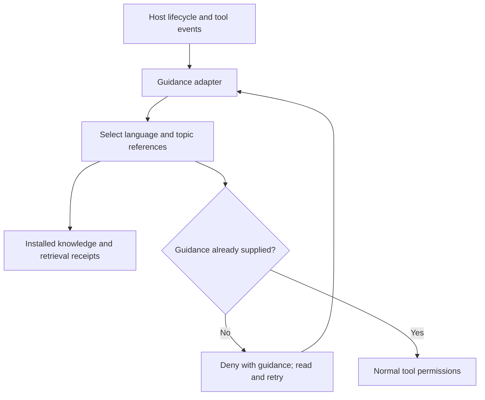

# Monolithic Agent Guidelines

[](https://github.com/theocarranza/monolithic-agent-guidelines/releases/tag/v1.4.0)
[](https://www.python.org/)
[](CODEX.md)
[](INSTALL.md)
[](CURSOR.md)
[](#license-and-attribution)

Karpathy-inspired coding principles with on-demand functional-programming
references for Dart and TypeScript. Install them across supported local agent
hosts, load relevant guidance when work requires it, and keep project verification
in the project's own workflow.

> Skills describe how to work. Guidance hooks supply the relevant instructions
> before supported tools proceed. They do not run a second delivery workflow.

## Why this exists

Agents can hide assumptions, add unnecessary abstractions, change unrelated code,
and declare work finished without useful evidence. Four compact principles address
those habits. Detailed references remain in installed, versioned files so agents
can fetch the language and topic they need instead of carrying every document in
context. Reloading after task changes or compaction reduces dependence on memory.

| Principle | Expected behavior |
| --- | --- |
| Think Before Coding | Expose assumptions, ambiguity and tradeoffs |
| Simplicity First | Build only what the task needs |
| Surgical Changes | Keep every edit tied to the request |
| Goal-Driven Execution | Define observable success and verify actual work |

## Documentation

| Area | Guide |
| --- | --- |
| Installation and host selection | [INSTALL.md](INSTALL.md) |
| Codex and persistent startup guidance | [CODEX.md](CODEX.md) |
| Hook lifecycle, retrieval and limits | [HOOKS.md](HOOKS.md) |
| Cursor support | [CURSOR.md](CURSOR.md) |
| Reference routing | [Knowledge manifest](knowledge/manifest.md), [catalog](knowledge/catalog.tsv) |
| Full principles | [Core skill](skills/karpathy-guidelines/SKILL.md) |
| Examples | [EXAMPLES.md](EXAMPLES.md) |
| Release history | [CHANGELOG.md](CHANGELOG.md) |

## Architecture at a glance



Only the host hook writes retrieval bookkeeping. The query command reads local
files. There is no Stop/PostToolUse hook, mandatory verifier, completion receipt,
or sandbox write-grant step in the default flow. The fourth principle still calls
for appropriate tests and honest reporting; project instructions and development
harnesses define any mandatory delivery checks.

## Features and host support

- Versioned core, shared, Dart and TypeScript guidance with source metadata.
- Read-only catalog, search and document/section retrieval.
- Guidance delivery before guarded tools, with refresh after resume or compaction.
- Strict Dart references and portable TypeScript guidance; project rules prevail.
- One authoritative implementation per behavior, with examples for interchangeable sources, entry points and test dependencies; see [the shared reference](knowledge/shared/canonical-behavior.md).
- One installer for all detected supported local hosts or a selected subset.
- Separate, preview-first Codex setup for persistent startup guidance.

| Host | Skills and references | Automatic guidance hooks |
| --- | --- | --- |
| Codex | Yes | Four retrieval lifecycle events; host trust required |
| Claude Code | Yes | Three retrieval lifecycle events; host controls apply |
| Cursor | Portable local package | Not provided by this package |
| ChatGPT | Manual configuration; see CODEX.md | Not established by local shell installation |

## Requirements

| Requirement | Notes |
| --- | --- |
| Python | 3.9+ for runtime and installer |
| Bash and Git | One-command bootstrap from a pinned release tag |
| Codex / Claude CLI | Required when explicitly selecting that native plugin installation |
| Cursor | Supports local portable plugins; organizational import policies may apply |
| Operating system | Linux for the shipped hook state implementation |

## Installation

All detected supported local hosts:

```bash
curl -fsSL https://raw.githubusercontent.com/theocarranza/monolithic-agent-guidelines/v1.4.0/install.sh | bash -s -- --host all
```

Only selected hosts:

```bash
curl -fsSL https://raw.githubusercontent.com/theocarranza/monolithic-agent-guidelines/v1.4.0/install.sh | bash -s -- --host codex,cursor
```

From a repository checkout, inspect the planned targets first:

```bash
bash install.sh --host all --dry-run
```

Installation is user-scoped and reports unavailable hosts. It does not install
client applications, sign in, trust hooks, change security settings or edit
persistent instructions. ChatGPT web configuration remains manual. See
[installation details and preservation rules](INSTALL.md).

## Quick start

Restart the selected host. In Codex, open /hooks and review/trust this package's
four retrieval hooks. Start a fresh session and ask:

```text
Run pwd. If the guidance hook blocks it, read the supplied guidance
and retry once within this turn. Do not modify project files.
```

The initial denial should contain the relevant references. The retry should run
subject to normal permissions, and the turn should finish without a verifier or
extra state-write permission request from this plugin. Other installed plugins
can have their own checks.

For deliberate Codex skill invocation:

```text
Use $monolithic-agent-guidelines:karpathy-guidelines for this task.
```

For persistent startup guidance, separately invoke
$monolithic-agent-guidelines:setup. It previews an AGENTS.md change for approval.
Installing the plugin alone does not change that file.

## Repository layout

| Path | Purpose |
| --- | --- |
| skills/ | Core principles and explicit Codex setup |
| knowledge/ | Versioned references and routing catalog |
| retrieval/ | Read-only catalog, search and fetch command |
| enforcement/adapters/ | Host payloads, reference delivery and reloads |
| hooks/ | Registered guidance-only hook definitions |
| scripts/ | Host installation and generated-package checks |
| dist/codex/ | Generated legacy package for Codex 0.166.0 compatibility |
| tests/ | Retrieval, adapter, installation and regression checks |

## Development and testing

Run from the repository checkout:

```bash
python3 scripts/build_codex_package.py
python3 scripts/build_codex_package.py --check
python3 -m unittest discover -s tests -q
python3 tests/native_codex_discovery.py /absolute/path/to/codex
```

Edit authoritative source files, then regenerate dist/codex. Do not edit installed
copies or generated files directly. The native test installs into a disposable
home and reads the real Codex hook registry without a model. Adapter tests check
initial denial, retry, scope reloads and normal completion. Installer tests use
isolated homes and controlled client processes. Native registry checks and unit
tests do not prove model compliance, all host versions, or enterprise policy.

## Status and limitations

The default flow is guidance retrieval only. Shell tools need no write access to
plugin bookkeeping. Disabled/untrusted hooks, unsupported tool paths and host
errors can bypass retrieval; hooks are not a complete security boundary or proof
of understanding. Verification of actual code remains a project responsibility.
Legacy verifier files are retained but unregistered and are not part of the
current hook workflow. No existing user files or instruction blocks are deleted
by this change.

## License and attribution

MIT declarations and original author attribution are preserved. This project
adapts [multica-ai/andrej-karpathy-skills](https://github.com/multica-ai/andrej-karpathy-skills),
with original author metadata naming forrestchang, and principles inspired by
[Andrej Karpathy's observations](https://x.com/karpathy/status/2015883857489522876).
The adaptation adds host packaging, setup and reference retrieval; it does not
claim endorsement by Karpathy or the upstream authors. Historical Chinese
upstream documentation remains in [README.zh.md](README.zh.md).
