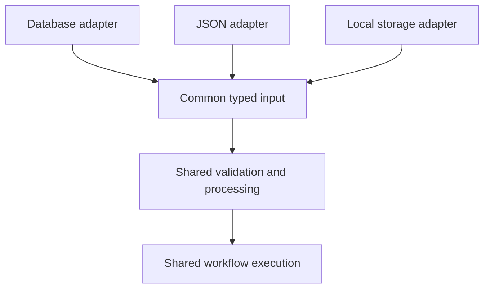

# One behavior, one authoritative implementation

## Rule
Keep a single processing and execution flow for the same behavior. Isolate
differences in data sources, storage and external services behind adapters with
a common contract. Pass those inputs or capabilities into the shared flow. Do
not create parallel implementations of the same business rules for different
sources or entry points. This supports Simplicity First and Surgical Changes;
it does not add or replace an original principle.

The common contract describes domain inputs or narrow capabilities using the
project's existing types. It is not permission to introduce a generic framework,
new dependencies or an abstraction before equivalent behavior actually exists.
The shared flow may compose small functions; it need not be one large function.

## Different sources, shared workflow
A feature processes records from a database, a JSON file or local storage.

Avoid separate processDatabaseRecords, processJsonRecords and
processStoredRecords implementations that each validate domain rules, process
records and orchestrate the workflow.

Instead, each source adapter decodes its own representation and produces the
same typed record input or explicit source failure. One shared use case applies
domain validation, processes those records and executes the workflow. Transport
and format validation belong at the source boundary; domain rules remain shared.

## Different entry points, shared use case
An application, a scheduled job and a command-line tool can create invoices.

Avoid implementing discounts, taxes and eligibility separately in each entry
point. Each entry point decodes and authorizes its request at the appropriate
boundary, then invokes the same createInvoice use case with the common request
contract. Domain eligibility rules belong in that shared use case. Presentation
and transport responses can differ without duplicating invoice creation.

## Production and tests, shared execution
A workflow depends on a repository, a clock and a notification service.

Avoid a testMode branch that skips steps or calls a simplified test workflow.
Inject an in-memory repository, a controlled clock and a recording notification
adapter into the production workflow. Tests exercise that same implementation
through the same contracts and assert observable results and effects.

Test doubles must preserve relevant production semantics, including failures,
absence and ordering. Shared orchestration tests do not replace adapter or
integration checks against real infrastructure.

## Legitimate differences and determinism
Standard and express delivery can have different pricing strategies because
their business behavior differs. Reading an order from JSON instead of a
database does not justify another implementation of either pricing rule.

One flow may branch on actual business decisions and represent success,
failure or absence. Select distinct strategies explicitly where the domain
requires them. Do not force similar-looking but semantically different behavior
into a common implementation.

Determinism and a single authoritative implementation are separate properties.
Two duplicated functions can both be deterministic and still violate this rule.
The workflow can perform effects through injected capabilities while its domain
calculations remain deterministic; injection alone does not make effects pure.

## Review questions
- Where is the authoritative implementation of this behavior?
- Do all equivalent entry points invoke it?
- Do tests exercise that same implementation?
- Would changing a business rule require editing multiple execution paths?
- Are differences actual business strategies or only source/environment details?

If the number of business-rule edits grows with the number of sources, entry
points or environments, look for duplicated behavior. Preserve project contracts
and scope; this rule does not authorize unrelated refactoring.
